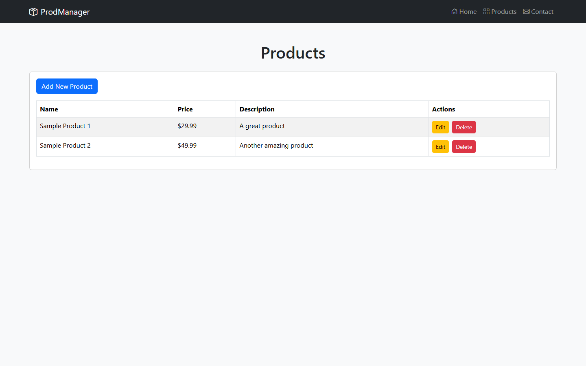
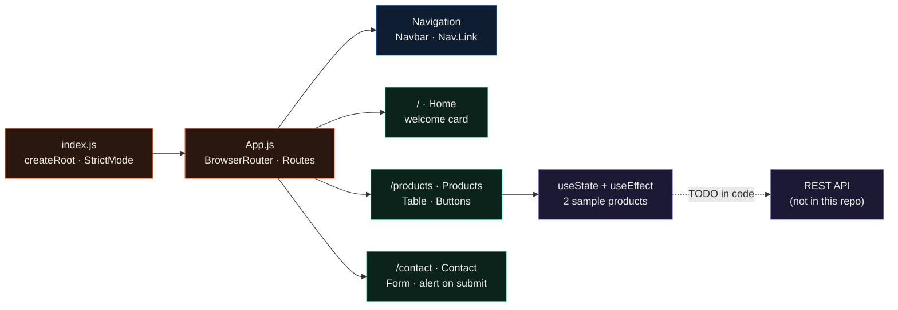
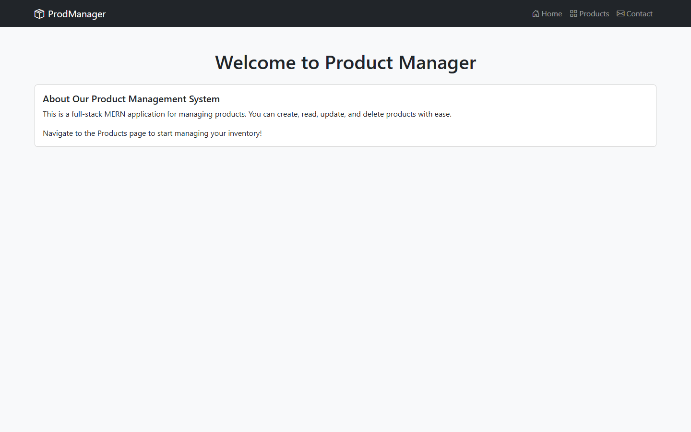
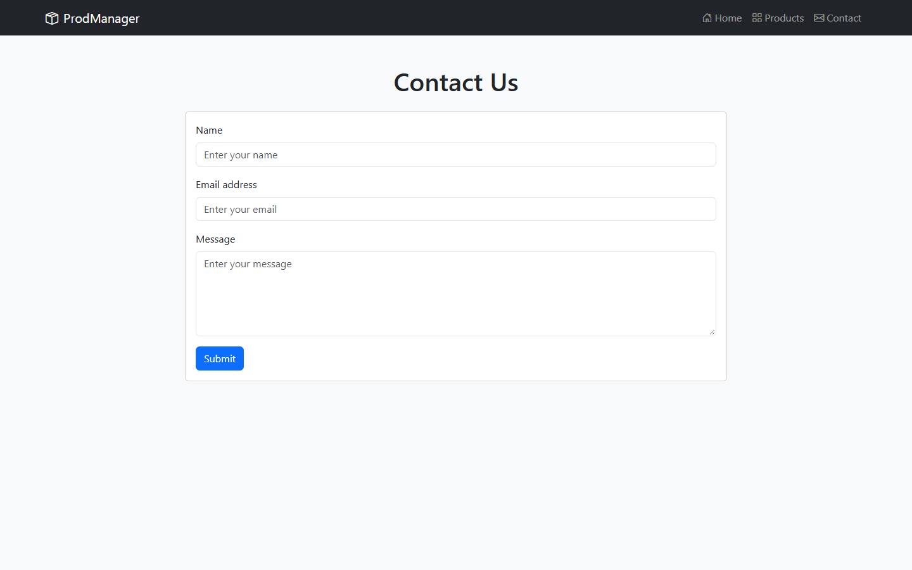
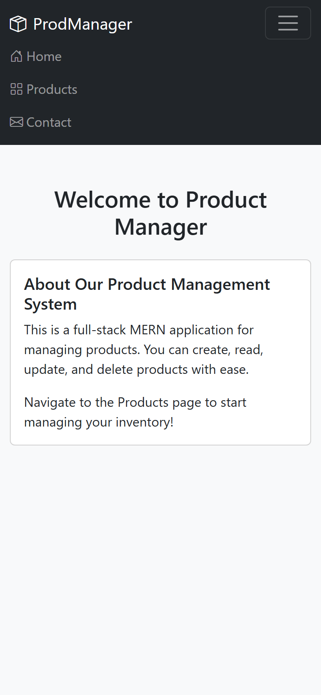
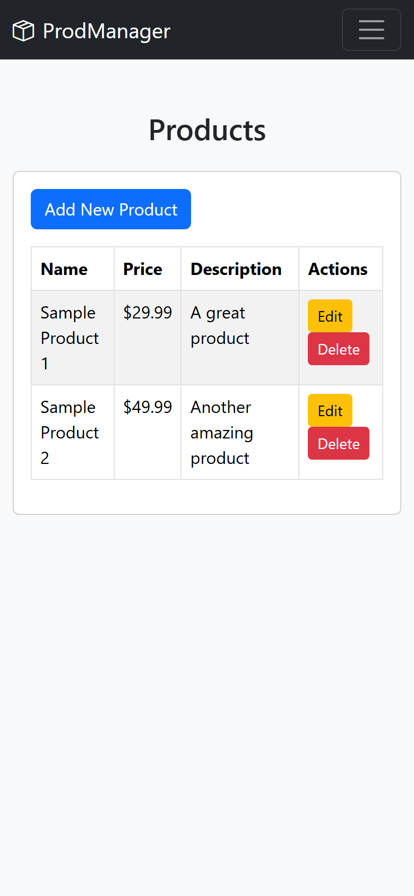

<div align="center">

# ProdManager

**The React front end of a product manager: three routed pages (home, product table, contact form) built with React Router 7 and React Bootstrap.**




</div>

This is a work in progress: the three pages render, but there is no backend yet and the Add, Edit and Delete buttons do nothing (see Limitations).
I built this as the week 2 class activity of a MERN stack tutorial: the React UI meant to sit on top of an Express and
MongoDB API. It is the client only. The product list is two sample rows set in a `useEffect`, and the buttons are laid
out but not wired to anything yet.

This is the newer and more complete of two versions. [product-management-app](https://github.com/EllE961/product-management-app)
is the Vite scaffold I started about a week earlier, which renders a single "Hello World!" page; this repo was rebuilt on
Create React App and adds routing, Bootstrap styling and the three pages.

## Features

- A dark, sticky React Bootstrap navbar links the three routes with Bootstrap Icons and collapses into a toggle menu below 992 px.
- `/products` shows a striped, bordered table of name, price and description with Edit and Delete buttons per row, plus an Add New Product button.
- The product rows live in component state and are seeded in a `useEffect`, which is where the API fetch goes once there is a backend.
- `/contact` is a form with required name, email and message fields; submitting it prevents the page reload and shows a browser alert.
- `/` is a welcome card that points to the products page.
- The layout holds up on a phone: at 390 px the table still fits and the menu collapses (screens below).

## How it works



`App.js` wraps everything in a `BrowserRouter`, renders the navbar on every page and maps the three paths to page
components in `src/pages/`. Bootstrap's CSS and the Bootstrap Icons font are imported once in `App.js`, so every page
uses plain React Bootstrap components (`Container`, `Card`, `Table`, `Form`) with no custom CSS beyond a light grey
page background.

## Screens

 

<p align="center">

&nbsp;&nbsp;

</p>

All screenshots are from the dev server in headless Chrome, at 1440x900 and 390x844.

## Quickstart

```bash
git clone https://github.com/EllE961/prodmanager.git
cd prodmanager
npm ci
npm start        # dev server on http://localhost:3000
npm run build    # production bundle in build/
```

The production build's main bundle is 88.6 kB of JavaScript and 46.0 kB of CSS after gzip, nearly all of the CSS
being Bootstrap and the icon font.

## Repository map

```text
src/
  index.js                  entry point, mounts <App /> in StrictMode
  App.js                    router, global Bootstrap and icon imports
  components/Navigation.js  responsive navbar
  pages/Home.js             welcome card
  pages/Products.js         product table, sample data in useEffect
  pages/Contact.js          contact form
  App.test.js               Create React App placeholder test
public/                     index.html, icons, manifest
docs/assets/                screenshots used in this README
```

## Limitations

- There is no backend. Products are hardcoded, Add, Edit and Delete have no handlers, and the contact form only shows an alert.
- The home card describes a full-stack MERN app, but this repo only holds the React client from that tutorial.
- `npm test` fails. The only test is the Create React App placeholder that looks for a "learn react" link, and Jest 27 in `react-scripts` 5 can't resolve React Router 7's package exports.

## License

MIT, see [LICENSE](LICENSE).
